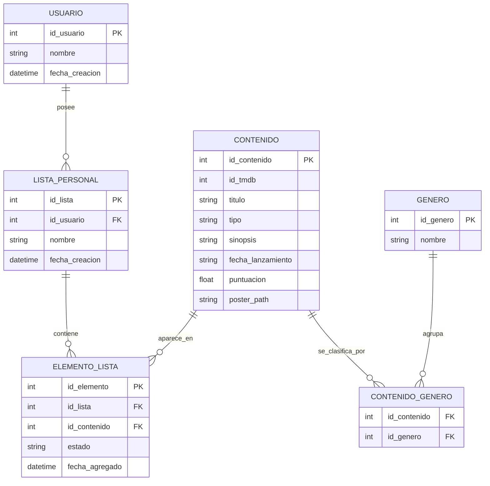
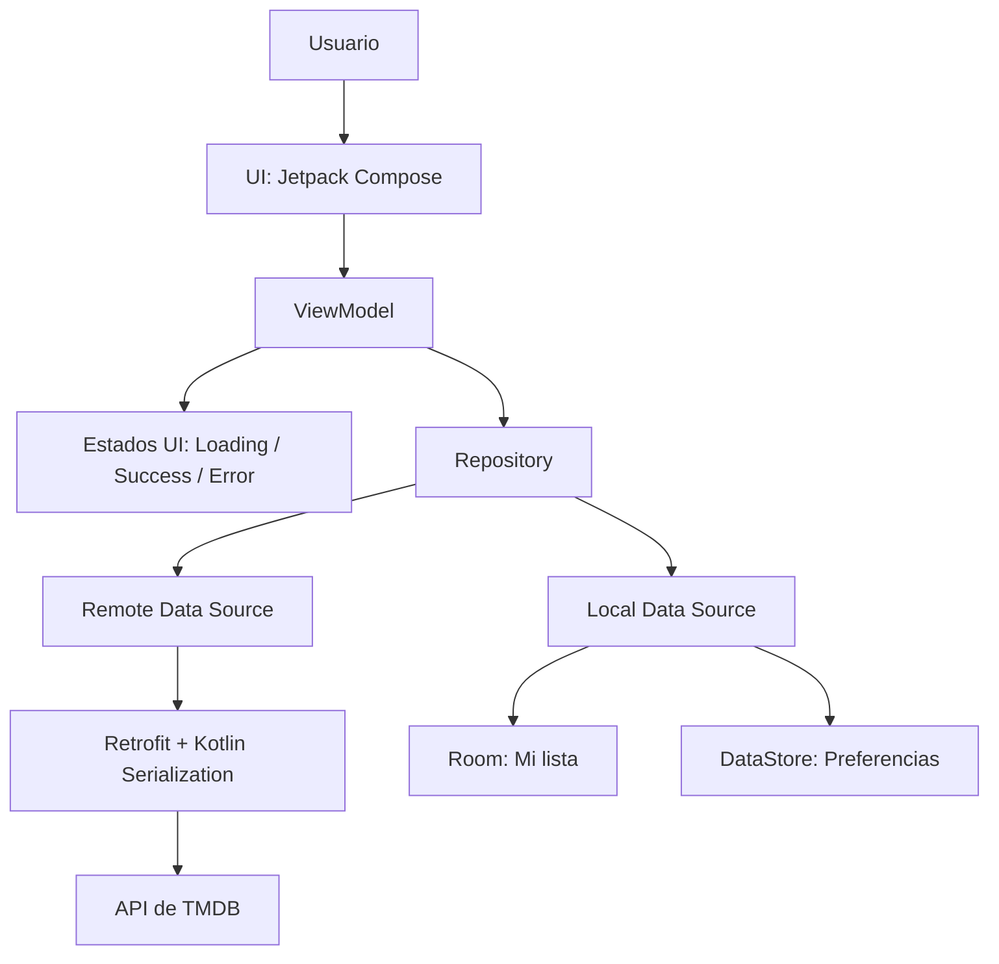

# CineMora

Proyecto de diseño de una aplicación Android para consultar contenido cinematográfico, organizar listas personales y guardar preferencias.

## Prototipo UI/UX

Ver prototipo en [Google Stitch](https://stitch.withgoogle.com/projects/10239007104782718379)

## Diagrama entidad-relación

## Diagrama de arquitectura

## Pantallas planificadas

1. Inicio y exploración de películas o series.
2. Detalle de contenido: título, sinopsis, géneros, puntuación y póster.
3. Lista personal del usuario.
4. Preferencias de la aplicación.

## Recursos provenientes de la API TMDB

- Películas y series.
- Títulos.
- Sinopsis.
- Fecha de lanzamiento.
- Puntuación.
- Póster.
- Géneros.
