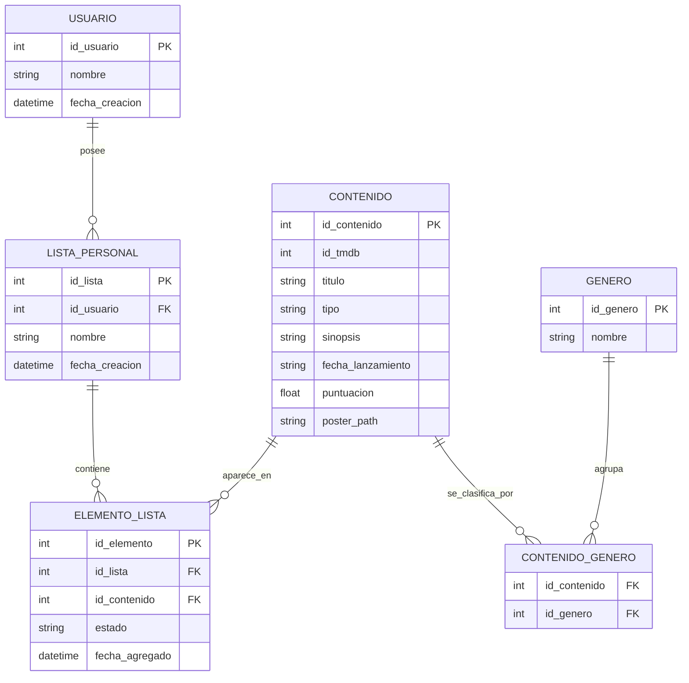
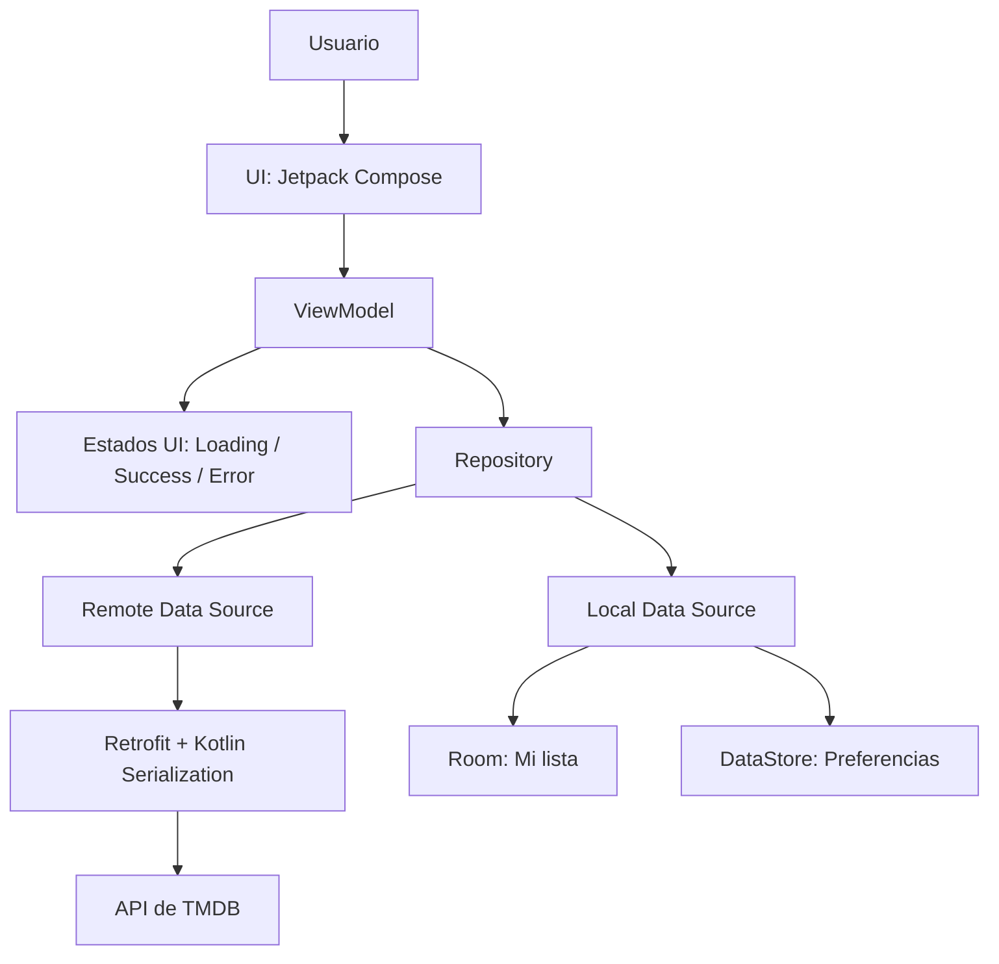

# CineMora

Proyecto de diseño de una aplicación Android para consultar contenido cinematográfico, organizar listas personales y guardar preferencias.

## Prototipo UI/UX

Ver prototipo en Google Stitch([Mermaid Live Editor](https://mermaid.live/edit#pako:eNptUctOwzAQ_BVrTyCSKg3Oy-KCWipx4MQNVUJuYlIrsV38UEtL_53EkFBafLFn1jOeXR-gVBUDAmVLjZlzWmsqlhJ1615yQVt09xmGaO7K5pJdcLO-ZF_YStM_NEE3XFpEa3ZOP1vNZY1qJiumT4u9xDxR0R2vrs8Kglo2kD62j3f4JtBoumK0malW6bFgtlwMwg6-O1o2Az6e-vWNjX5hn93wPXuUC8bsSJdUPlD7r96P4DfQSqkWcfO65W01ktrJUQsB1JpXQKx2LADBtKA9BO-xBLtmgi2BdEfNKrcLK6qbsPTNwVL2-g2VL0qJwUIrV6-BvNHWdMhtqm5mP787XvFDnyknLZA49hZADrADMs3jSREXcbenCY5wEcAHkCSbFEWGC5ynWY6LaY6PAez9o9EkxbdpjtN8GmdREkfJ8Qtl0bQM))

## Diagrama entidad-relación

## Diagrama de arquitectura

## Pantallas planificadas

1. Inicio y exploración de películas o series.
2. Detalle de contenido: título, sinopsis, géneros, puntuación y póster.
3. Lista personal del usuario.
4. Preferencias de la aplicación.

## Recursos provenientes de la API TMDB

- Películas y series.
- Títulos.
- Sinopsis.
- Fecha de lanzamiento.
- Puntuación.
- Póster.
- Géneros.