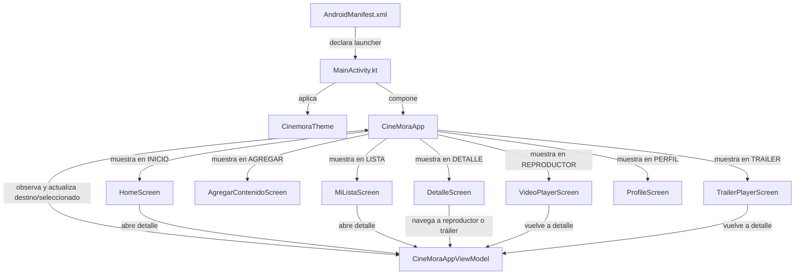
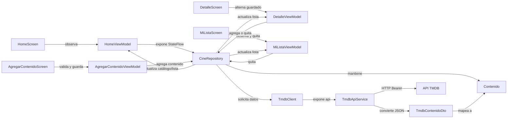
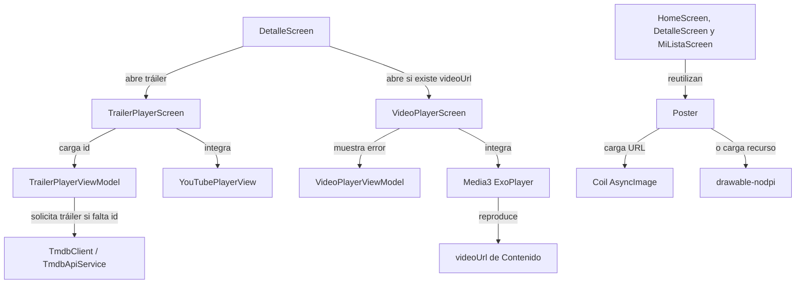

# Arquitectura y flujo de ejecución — CineMora (avance 1)

> Elaborado a partir de la estructura y el código actuales. Describe lo verificable en los archivos; no garantiza que servicios externos como TMDB, YouTube o Archive.org respondan durante la ejecución.

## 1. Introducción

CineMora es una aplicación Android para explorar contenido cinematográfico y organizar una lista personal. El usuario puede ver un catálogo, abrir el detalle de un título, añadirlo o retirarlo de **Mi lista**, agregar un título local, abrir tráileres y reproducir algunos contenidos con URL de video. También existe una pantalla de perfil de demostración.

El proyecto contiene un único módulo Android (`app`) y está escrito en Kotlin. Usa Jetpack Compose y Material 3 para la UI; `ViewModel`, corrutinas y `StateFlow` para estado; Coil para pósteres de URL; Media3 ExoPlayer para video; Android YouTube Player para tráileres; y `HttpURLConnection` con `org.json` para consultar TMDB. El permiso `INTERNET` se declara en `app/src/main/AndroidManifest.xml`.

El catálogo inicia con contenido local en `CineRepository`. Al crearse ese repositorio intenta enriquecer dichos títulos y añadir tendencias de TMDB. La lista del usuario y el catálogo modificado viven solamente en memoria.

## 2. Estructura del proyecto

El árbol omite directorios generados y de IDE (`.gradle/`, `build/` y `.idea/`). Todas las rutas listadas existen en el proyecto.

```text
Android-desing-CineMora/
├── README.md                                  # Alcance, diagramas y funciones planeadas.
├── settings.gradle.kts                        # Proyecto raíz y módulo :app.
├── build.gradle.kts                           # Plugins de nivel raíz.
├── gradle.properties                          # Propiedades de Gradle.
├── gradlew / gradlew.bat                      # Gradle Wrapper.
├── gradle/
│   ├── libs.versions.toml                     # Versiones y dependencias.
│   ├── gradle-daemon-jvm.properties           # Configuración JVM del daemon.
│   └── wrapper/
│       ├── gradle-wrapper.jar                 # Binario del wrapper.
│       └── gradle-wrapper.properties          # Configuración del wrapper.
├── docs/
│   └── arquitectura_y_flujo.md                # Este documento.
└── app/
    ├── build.gradle.kts                       # SDK, BuildConfig y dependencias.
    └── src/
        ├── main/
        │   ├── AndroidManifest.xml            # Permiso y actividad lanzadora.
        │   ├── keepRules/rules.keep            # Reglas de conservación de empaquetado.
        │   ├── java/com/example/cinemora/
        │   │   ├── MainActivity.kt            # Entrada Android y raíz Compose.
        │   │   ├── model/Contenido.kt         # Modelo de película o serie.
        │   │   ├── data/remote/
        │   │   │   ├── TmdbClient.kt          # Punto de acceso remoto.
        │   │   │   ├── TmdbApiService.kt      # HTTP, JSON y mapeo de TMDB.
        │   │   │   └── dto/TmdbContenidoDto.kt # DTO temporal de TMDB.
        │   │   ├── repository/CineRepository.kt # Estado compartido del catálogo/lista.
        │   │   ├── viewmodel/
        │   │   │   ├── CineMoraAppViewModel.kt # Navegación y selección.
        │   │   │   ├── HomeViewModel.kt        # Datos para Inicio.
        │   │   │   ├── DetalleViewModel.kt     # Guardar o quitar de Mi lista.
        │   │   │   ├── MiListaViewModel.kt     # Datos y eliminación de la lista.
        │   │   │   ├── AgregarContenidoViewModel.kt # Formulario y validación.
        │   │   │   ├── TrailerPlayerViewModel.kt # Id/carga del tráiler.
        │   │   │   └── VideoPlayerViewModel.kt # Error del reproductor.
        │   │   └── ui/
        │   │       ├── components/CineComponents.kt # Encabezado, póster y colores.
        │   │       ├── screen/
        │   │       │   ├── CineMoraApp.kt      # Navegación por estado y Scaffold.
        │   │       │   ├── HomeScreen.kt       # Catálogo.
        │   │       │   ├── DetalleScreen.kt    # Detalle y acciones.
        │   │       │   ├── MiListaScreen.kt    # Lista personal.
        │   │       │   ├── AgregarContenidoScreen.kt # Formulario de título.
        │   │       │   ├── TrailerPlayerScreen.kt # Reproductor YouTube.
        │   │       │   ├── VideoPlayerScreen.kt # Reproductor Media3.
        │   │       │   └── ProfileScreen.kt    # Perfil fijo de demostración.
        │   │       └── theme/
        │   │           ├── Color.kt            # Paleta Material.
        │   │           ├── Theme.kt            # CinemoraTheme.
        │   │           └── Type.kt             # Tipografía.
        │   └── res/
        │       ├── drawable/                   # Capas XML de icono.
        │       ├── drawable-nodpi/             # Seis PNG de pósteres locales.
        │       ├── mipmap-*/                   # Iconos launcher por densidad.
        │       ├── values/                     # strings, tema XML y colors.xml.
        │       └── xml/                        # Plantillas de backup/extracción.
        ├── test/java/com/example/cinemora/
        │   └── ExampleUnitTest.kt              # Prueba de plantilla 2 + 2 = 4.
        └── androidTest/java/com/example/cinemora/
            └── ExampleInstrumentedTest.kt      # Prueba del nombre de paquete.
```

`app/build.gradle.kts` lee `TMDB_ACCESS_TOKEN` desde `local.properties` y lo coloca en `BuildConfig.TMDB_ACCESS_TOKEN`. `gradle/libs.versions.toml` declara Compose, Lifecycle, Coil, Media3 y Android YouTube Player, entre otras dependencias.

## 3. Diagrama del flujo de datos y conexión de archivos

### Inicio y navegación



No se usa Navigation Compose. `CineMoraApp.kt` selecciona la pantalla con un `when (destino)` y conserva el elemento elegido dentro de `CineMoraAppViewModel`.

### Catálogo, Mi lista y TMDB



`CineRepository` es un `object`, así que las pantallas comparten los mismos flujos. TMDB puede complementar el catálogo; **Mi lista** no se envía a TMDB ni se persiste.

### Pósteres y reproducción



## 4. Análisis de archivos e interconexión

### Modelos y DTO

`model/Contenido.kt` define el modelo que utilizan repositorio, ViewModels y UI. Agrupa los datos de presentación y los opcionales de integración:

```kotlin
data class Contenido(
    val id: Int,
    val titulo: String,
    // ...
    val videoUrl: String? = null,
    val trailerYoutubeId: String? = null,
    val posterUrl: String? = null,
    val tmdbId: Int? = null
)
```

`ui/components/CineComponents.kt` lee `posterUrl` antes de `posterRes`; `DetalleScreen` solo ofrece reproducir si `videoUrl` no es nulo. `TmdbContenidoDto.kt` es un modelo temporal para datos remotos: sus géneros son IDs y `posterPath` aún no es una URL. Una extensión privada en `TmdbApiService.kt` lo transforma a `Contenido`; el DTO no llega directamente a una pantalla.

### Conexión remota y API de TMDB

`TmdbClient.kt` es una fachada mínima que expone `TmdbApiService`. El servicio es un `object` que trabaja en `Dispatchers.IO`, usa `HttpURLConnection` y `JSONObject`, agrega el token Bearer y contiene estas funciones:

- `obtenerTendencias()`: solicita `/trending/all/day?language=es-CO`, acepta solo `movie` y `tv` y los mapea al modelo de dominio.
- `enriquecerContenido(contenido)`: busca por título para completar `posterUrl`, `tmdbId` y, si hace falta, tráiler.
- `obtenerTrailer(tmdbId, tipo)`: obtiene videos para película o serie.
- `obtenerTrailerInterno(...)`: busca primero videos `es-CO`, luego `en-US`, y prefiere tráiler oficial de YouTube.
- `nombreGenero(...)`: traduce solo los IDs de su mapa local.

Si el token está vacío, las tendencias devuelven una lista vacía:

```kotlin
val token = BuildConfig.TMDB_ACCESS_TOKEN.trim()
if (token.isBlank()) return@withContext emptyList()
```

Las excepciones y respuestas no exitosas se absorben con `runCatching`; por ello esta capa conserva el objeto original o devuelve una colección vacía, sin publicar un error de catálogo a la UI.

### Repositorio

`repository/CineRepository.kt` es la fuente única de datos de esta versión. Mantiene `_catalogo` y `_miLista` como `MutableStateFlow`, y expone valores de solo lectura:

```kotlin
val catalogo: StateFlow<List<Contenido>> = _catalogo.asStateFlow()
val miLista: StateFlow<List<Contenido>> = _miLista.asStateFlow()
```

El catálogo inicial tiene ocho elementos locales. Cuatro tienen URL de Archive.org y tipo `"película completa"`; otros usan los recursos `poster_space`, `poster_fantasy`, `poster_noir`, `poster_desert`, `poster_library` o `poster_arctic`. La lista inicia vacía.

El bloque `init` ejecuta `actualizarDesdeTmdb()` mediante `CoroutineScope(SupervisorJob() + Dispatchers.IO)`. Primero enriquece cada título local y luego añade tendencias cuyo título no exista, comparando en minúsculas. `agregarAMiLista` evita duplicados con `id` y `tipo`; `quitarDeMiLista` filtra por los mismos campos. `agregarContenido(titulo)` calcula el id siguiente y añade un elemento con metadatos predeterminados y `R.drawable.poster_desert`.

No hay DAO, entidad Room, DataStore, SharedPreferences ni archivo de datos en esta capa.

### ViewModels

- `CineMoraAppViewModel.kt`: define `Destino` (`INICIO`, `LISTA`, `AGREGAR`, `DETALLE`, `REPRODUCTOR`, `TRAILER`, `PERFIL`), el destino actual y el `Contenido` seleccionado. Su método central conecta una tarjeta con Detalle:

  ```kotlin
  fun abrirDetalle(contenido: Contenido) {
      _seleccionado.value = contenido
      _destino.value = Destino.DETALLE
  }
  ```

- `HomeViewModel.kt`: expone `CineRepository.catalogo` y `miLista`. Tiene `actualizarCatalogo()`, pero `HomeScreen` no lo invoca actualmente.
- `DetalleViewModel.kt`: expone `miLista` y, en `alternarGuardado`, llama a `agregarAMiLista` o `quitarDeMiLista`.
- `MiListaViewModel.kt`: expone `miLista` como `contenidos` y delega la eliminación al repositorio.
- `AgregarContenidoViewModel.kt`: conserva `titulo` y `esError`. `guardar()` valida texto, agrega el contenido local, limpia el campo y devuelve si tuvo éxito.
- `TrailerPlayerViewModel.kt`: conserva `videoId` y `cargando`. Reutiliza `trailerYoutubeId` o consulta TMDB con `tmdbId` desde `viewModelScope`.
- `VideoPlayerViewModel.kt`: conserva un mensaje `error`, que se asigna si ExoPlayer informa fallo.

### Pantallas

- `CineMoraApp.kt` es el contenedor: obtiene ViewModels con `viewModel()`, observa destino/selección con `collectAsStateWithLifecycle()` y presenta el composable de cada destino. Su barra inferior navega a Inicio, Mi lista y Agregar. Se oculta solo en `DETALLE` y `PERFIL`; por la condición actual sigue existiendo en Reproductor y Tráiler.
- `HomeScreen.kt` observa catálogo y lista, usa `LazyVerticalGrid`, abre detalle al tocar la tarjeta y muestra **En lista** para elementos guardados. **Ver perfil** dispara su callback.
- `DetalleScreen.kt` muestra el modelo elegido, observa si está guardado, alterna la lista y presenta acciones de reproducir, tráiler y búsqueda externa de JustWatch. Los datos visuales Dirección `CineMora`, Audio `Original` y Clasif. `+13 años` son textos fijos; no vienen de TMDB ni de `Contenido`.
- `MiListaScreen.kt` presenta estado vacío o un `LazyColumn`, abre detalle y elimina. Los chips de filtro y el icono de filtrar no tienen lógica en sus `onClick`; `RecommendationCard()` también es solo visual.
- `AgregarContenidoScreen.kt` enlaza `OutlinedTextField` con el ViewModel y muestra validación/Snackbar. Sus chips de categorías no modifican el nuevo elemento. Aunque su texto pedagógico menciona `mutableStateOf`, la implementación usa `StateFlow` en el ViewModel.
- `TrailerPlayerScreen.kt` llama `viewModel.cargar(contenido)` en `LaunchedEffect`, integra `YouTubePlayerView` con `AndroidView`, observa el ciclo de vida y libera el reproductor en `DisposableEffect`.
- `VideoPlayerScreen.kt` crea ExoPlayer con `contenido?.videoUrl`, lo muestra en `PlayerView`, mantiene la pantalla encendida mientras está abierto y libera recursos al salir.
- `ProfileScreen.kt` recibe siempre `"usuario_demo"` desde `CineMoraApp`; no usa usuario, repositorio ni autenticación reales.

### Componentes, tema y entrada

`CineComponents.kt` concentra los colores `Fondo`, `Tarjeta`, `Morado` y `TextoSecundario`, además de:

- `BrandHeader()`: cabecera visual. El avatar no recibe clic; el acceso funcional al perfil está en Inicio.
- `Titulo(...)`: título/subtítulo reutilizable, definido pero no invocado por las pantallas revisadas.
- `Poster(...)`: usa Coil `AsyncImage` si hay URL, recurso local si hay `posterRes` o un icono de reserva.

`ui/theme/Theme.kt` define `CinemoraTheme`, con esquemas de `Color.kt` y `Typography` de `Type.kt`. En Android 12 o superior el color dinámico se activa por defecto. Algunas pantallas usan directamente los colores de `CineComponents.kt`, por lo que no todo el diseño depende de MaterialTheme.

`MainActivity.kt` conecta Android con Compose:

```kotlin
setContent {
    CinemoraTheme {
        CineMoraApp()
    }
}
```

## 5. Flujo de navegación y estado

1. `CineMoraApp` observa `destino`; `when (destino)` decide la pantalla.
2. La barra inferior llama `navegar(Destino.INICIO)`, `LISTA` o `AGREGAR`.
3. Una tarjeta de Inicio o Mi lista llama `abrirDetalle(contenido)`, que guarda el objeto completo en `seleccionado` y establece `DETALLE`.
4. Desde Detalle, **Reproducir película** va a `REPRODUCTOR` si hay `videoUrl`; **Ver tráiler** va a `TRAILER` si hay `trailerYoutubeId` o `tmdbId`.
5. Reproductor y Tráiler vuelven a Detalle; Detalle y Perfil vuelven a Inicio.

No existen `NavHost`, `NavController`, rutas, argumentos serializados ni pila de retroceso. Las pantallas de reproducción sí interceptan el botón físico Atrás con `BackHandler`; las otras no incluyen un manejador propio.

Las pantallas convierten los flujos a estado Compose:

```kotlin
val catalogo by viewModel.catalogo.collectAsStateWithLifecycle()
val lista by viewModel.miLista.collectAsStateWithLifecycle()
```

Cuando el repositorio cambia una lista, todos los composables que observan ese flujo se recomponen. Los ViewModels de Inicio, Detalle y Mi lista no guardan copias distintas: exponen los mismos flujos del repositorio.

## 6. Caso práctico paso a paso

### Abrir, seleccionar y guardar una película

1. Android lee `AndroidManifest.xml` y abre `MainActivity`.
2. `MainActivity.onCreate()` ejecuta `CinemoraTheme { CineMoraApp() }`.
3. `CineMoraAppViewModel` comienza en `Destino.INICIO`, por lo que aparece `HomeScreen`.
4. `HomeViewModel` referencia `CineRepository.catalogo`. El repositorio ya tiene datos locales e inicia su actualización TMDB en segundo plano; no hay indicador de carga o error para esa actualización.
5. La persona toca una tarjeta de `HomeScreen`. `onAbrir(item)` llama `CineMoraAppViewModel.abrirDetalle(item)`.
6. El ViewModel cambia `seleccionado` y `destino`; la recomposición muestra `DetalleScreen(item = seleccionado, ...)`.
7. Detalle calcula `guardado = item in lista`. Al tocar **Agregar a Mi lista** llama `DetalleViewModel.alternarGuardado(item, false)`.
8. Ese ViewModel invoca `CineRepository.agregarAMiLista(item)`, que añade el objeto si no existe la combinación de `id` y `tipo`.
9. `_miLista` emite el nuevo valor: Detalle muestra **Quitar de Mi lista**, Inicio puede mostrar la marca **En lista** y Mi lista presenta la tarjeta cuando se navega a ella.

### Quitar y agregar contenido

Para quitar, Detalle llama `alternarGuardado(item, true)` o Mi lista llama `MiListaViewModel.quitar(item)`; ambos llegan a `CineRepository.quitarDeMiLista` y recomponen la lista.

Para agregar al catálogo, la barra abre `AgregarContenidoScreen`; el campo llama `cambiarTitulo`, y el botón llama `guardar`. Con texto válido, `CineRepository.agregarContenido` crea un `Contenido` básico, actualiza `catalogo`, limpia el formulario y muestra un Snackbar. Solo se recoge título: no hay formulario de sinopsis, género, tipo o búsqueda inmediata en TMDB.

## 7. Estado actual y limitaciones

### Implementado

- Catálogo local, detalle, Mi lista y creación manual de un título durante la ejecución.
- Intento de obtener tendencias, pósteres y tráileres desde TMDB.
- Pósteres locales/remotos, YouTube Player para tráileres y Media3 para elementos con `videoUrl`.
- Perfil visual fijo y dos pruebas de plantilla, no pruebas funcionales del proyecto.

### Estado no persistente

`CineRepository` mantiene `catalogo` y `miLista` en `MutableStateFlow`. La selección/destino y el formulario también son estado en ViewModels. No hay Room, DataStore, SharedPreferences, archivo de datos ni base de datos remota propia; el código no garantiza conservar lista o contenido agregado al cerrar el proceso.

### Diferencias importantes entre README y código

| README / diseño descrito | Evidencia actual |
| --- | --- |
| Retrofit + Kotlin Serialization | No se declaran ni usan. TMDB emplea `HttpURLConnection` y `org.json`. |
| Room para Mi lista | No hay dependencia, entidad, DAO ni base de datos. La lista es un `MutableStateFlow`. |
| DataStore para preferencias | No hay dependencia ni uso de DataStore. Perfil no guarda preferencias. |
| Modelo relacional Usuario, Lista personal, Género y Elemento lista | No existen clases ni tablas para esas entidades; el modelo implementado es `Contenido`. |
| Detalle, lista personal y catálogo | Sí existen, con los límites de datos locales/en memoria descritos. |

### Límites observables

- La UI no informa fallo o carga de TMDB; los errores se absorben y se conservan datos locales o se obtienen listas vacías.
- TMDB depende de una credencial local correcta y de red; este documento no afirma que la consulta funcione en un dispositivo.
- Reproducir depende de una URL externa disponible; solamente cuatro contenidos iniciales tienen `videoUrl`.
- Filtros, recomendación, chips de categorías y avatar son elementos visuales sin acción funcional actual.
- **Dónde ver** abre una búsqueda externa de JustWatch; no obtiene resultados dentro de CineMora.
- La navegación no guarda historial y el perfil no representa autenticación ni usuario real.

## 8. Conclusión

El avance se organiza en un flujo claro: `MainActivity` inicia Compose; `CineMoraApp` selecciona pantallas con `Destino`; los ViewModels median las acciones; `CineRepository` comparte catálogo y lista mediante `StateFlow`; y `Contenido` conecta datos, UI y TMDB. Esta base permite estudiar cómo una modificación central se refleja de forma reactiva en varias pantallas.

El README plantea una arquitectura futura más amplia. Para llegar a ella todavía haría falta implementar persistencia, preferencias, las entidades relacionales y la capa HTTP indicada allí. La presente documentación diferencia esas propuestas de las funciones identificadas en el código actual.
