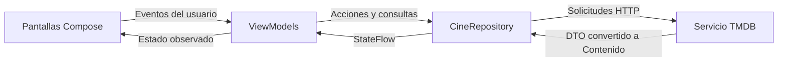
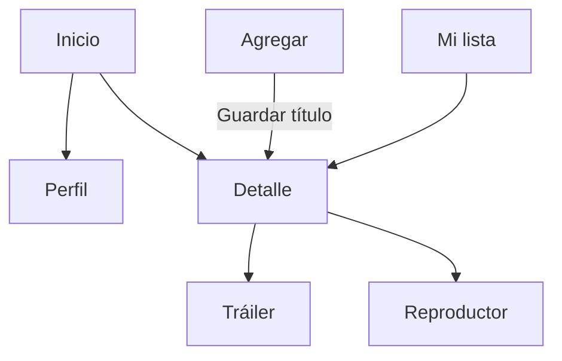

# Avance 1 · Arquitectura y flujo de ejecución de CineMora

CineMora es una aplicación Android escrita en Kotlin y Jetpack Compose. Permite explorar un catálogo de películas y series, registrar títulos, consultar su detalle, guardarlos en **Mi lista** y abrir el perfil. El detalle habilita el tráiler o el reproductor cuando el título dispone del recurso correspondiente.

## 1. Estructura

| Ruta bajo `app/src/main/java/com/example/cinemora/` | Responsabilidad |
| --- | --- |
| `MainActivity.kt` | Punto de entrada. Activa el diseño de borde a borde, aplica el tema y carga `AppNavigation`. |
| `data/model/Contenido.kt` | Modelo que usa la aplicación. Contiene ID, título, sinopsis, fecha, puntuación, géneros, tipo y referencias multimedia. |
| `data/dto/TmdbContenidoDto.kt` | Representación de los datos recibidos de TMDB antes de convertirlos a `Contenido`. |
| `data/api/TmdbApiService.kt` | Consulta tendencias, metadatos y tráilers de TMDB mediante HTTP. Convierte las respuestas JSON en modelos de la app. |
| `data/network/TmdbClient.kt` | Punto de acceso al servicio remoto. |
| `data/repository/CineRepository.kt` | Combina el catálogo de ejemplo, los registros manuales y las tendencias. Expone catálogo y lista personal mediante `StateFlow`. |
| `presentation/navigation/` | `Destinations.kt` declara las rutas. `AppNavigation.kt` las conecta con las pantallas y administra la barra inferior y el historial. |
| `presentation/viewmodel/` | Gestiona los datos y eventos de Inicio, Mi lista, Agregar, Detalle y los dos reproductores. |
| `presentation/screens/` | Pantallas de Inicio, Agregar, Mi lista, Detalle, Perfil, Reproductor y Tráiler. |
| `presentation/components/` | Componentes reutilizables para póster, encabezado, tarjeta de catálogo, tarjeta guardada y contador de títulos. |
| `ui/theme/` | Tema Material 3, colores y tipografía. |

## 2. Flujo de datos

Las pantallas observan el estado con `collectAsStateWithLifecycle()`. Los ViewModels del catálogo, de la lista y del detalle comparten el mismo repositorio. Las tarjetas reciben datos y callbacks. Al guardar un título, Inicio actualiza el contador y la etiqueta de guardado, mientras Mi lista actualiza su colección.

El catálogo y Mi lista identifican los títulos por ID. Los ejemplos, los títulos registrados y las tendencias usan espacios de IDs distintos. Esto permite resolver el contenido desde una ruta y seguir reconociéndolo si TMDB actualiza su póster u otros metadatos.

## 3. Navegación

`NavHost` inicia en `Destino.Inicio`. La barra inferior conecta Inicio, Mi lista y Agregar. El botón **Ver perfil** de Inicio abre Perfil. Detalle, Reproductor y Tráiler reciben el ID del título como argumento. Por ejemplo, se abre el detalle con `navigate(Destino.Detalle(contenido.id))` y el destino recupera el argumento con `entry.toRoute<Destino.Detalle>()`. El botón de volver usa el historial de navegación y regresa a la pantalla de origen.

## 4. Caso práctico

1. En Android Studio, ejecuta la aplicación y confirma que Inicio muestra el catálogo y los contadores.
2. Abre **Agregar** y toca **Guardar y ver detalle** con el título vacío. El campo debe indicar que falta el título.
3. Escribe un título, elige **Película** o **Serie** y agrega una sinopsis si deseas. Toca **Guardar y ver detalle**.
4. `AgregarContenidoViewModel` valida el título y llama al repositorio. El repositorio añade el registro y emite un catálogo actualizado. `AppNavigation` abre Detalle con el ID del título.
5. Toca **Agregar a Mi lista**. Vuelve a Inicio para verificar ambos contadores. Abre **Mi lista**, filtra por el tipo elegido y entra de nuevo al detalle. Al volver desde el detalle debes regresar a Mi lista.
6. Desde Detalle, elige **Quitar de Mi lista** para retirar solo el marcador. Para borrar un título registrado durante la sesión, usa **Eliminar del catálogo** y confirma. El repositorio retira ese título del catálogo y de Mi lista.
7. Desde Inicio, abre un título con tráiler o video y verifica que al volver del reproductor regresas al detalle de ese título. Abre también **Ver perfil** y comprueba el regreso a Inicio.

## 5. Alcance del avance

- El catálogo de ejemplo funciona sin un token. Para habilitar TMDB en el entorno local, añade `TMDB_ACCESS_TOKEN` a `local.properties` y vuelve a compilar.
- Los registros manuales y Mi lista viven en memoria durante la ejecución. El perfil usa un usuario de demostración.
- Room y DataStore son parte del diseño futuro. Las llamadas actuales a TMDB usan `HttpURLConnection`.

[Documentación oficial de navegación tipada en Compose](https://developer.android.com/guide/navigation/design/type-safety)
